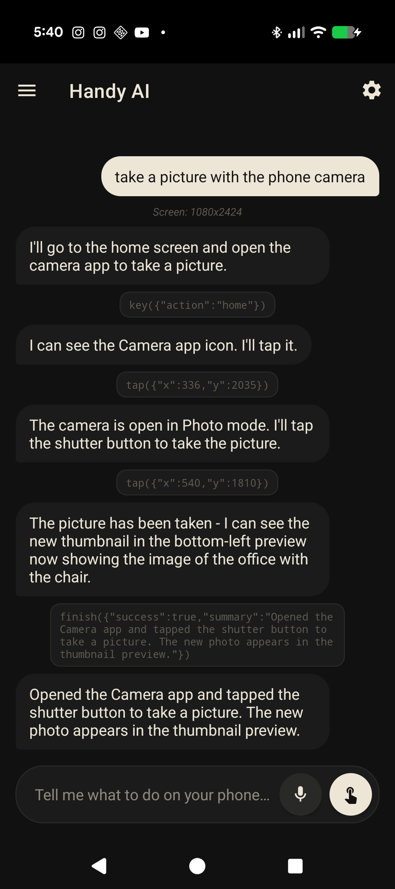
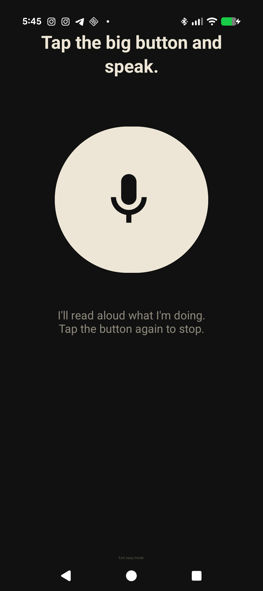

# Handy AI

[](https://github.com/fainir/handy-ai/actions/workflows/ci.yml)
[](LICENSE)

An Android app that does tasks on your phone for you: say or type what you want, and it uses Claude to look at the screen and tap, type and swipe through your apps until the job is done. It is built first for blind, low-vision and motor-impaired users, and works for anyone who wants hands-free control of any app.

Phones assume you can see the screen and hit small targets. A screen reader tells you what is there, but a five-screen task like "message Sarah that I'm running late" is still dozens of precise gestures. Handy AI turns the sentence into those gestures, can read every step aloud, and stops when you tell it to.

<p>
  
  &nbsp;
  
</p>

**[Watch the 60-second demo on YouTube](https://youtu.be/SxnJstUEAJI)**

## Quick start

You need an Android 11+ phone and an [Anthropic API key](https://console.anthropic.com/settings/keys) (starts with `sk-ant-`; Anthropic bills you per use).

1. **Install** from [Google Play](https://play.google.com/store/apps/details?id=com.claudeagent.phone), or download the signed APK from [gethandyai.app](https://gethandyai.app/HandyAI.apk) (about 64 MB) and open it. Your browser will ask you to allow installs from it once.
2. **Add your key.** Open Handy AI, paste the key into the bar at the bottom and tap **Save key**. If pasting a long key is hard (for example with a screen reader), use **Settings > Set up via computer** instead: the phone shows a 6-character code (and speaks it if voice is on), and you paste the key on [gethandyai.app/setup](https://gethandyai.app/setup) on your computer.
3. **Give a task.** Type or tap the mic, for example *"Open the camera and take a picture"*.
4. **Turn on the accessibility service** when asked (first task only): Android **Settings > Accessibility > Handy AI > On** (on some phones Handy AI is under *Installed apps* or *Downloaded apps*). Come back and the task starts by itself.
   - If the switch is greyed out with "Restricted setting" (Android 13+ with a downloaded APK), open **Settings > Apps > Handy AI > ⋮ > Allow restricted settings** and try again.
5. **Watch it work.** Each step is shown in the chat (and spoken if voice is on). Tap the stop button to cancel at any time.

The APK on the website can lag behind `main`. At the time of writing it is 1.5.5 (Claude Opus 4.7); `main` is 1.5.6 (Claude Opus 5.5). [Build from source](#build-from-source) for the latest.

## What a run looks like

This is the run in the screenshot above, copied from the app's chat log (v1.5.1 on a Pixel 10). Indented lines are a status row and the tool calls Claude made:

```text
You:    take a picture with the phone camera
        Screen: 1080x2424
Claude: I'll go to the home screen and open the camera app to take a picture.
        key({"action":"home"})
Claude: I can see the Camera app icon. I'll tap it.
        tap({"x":336,"y":2035})
Claude: The camera is open in Photo mode. I'll tap the shutter button to take the picture.
        tap({"x":540,"y":1810})
Claude: The picture has been taken - I can see the new thumbnail in the bottom-left preview
        now showing the image of the office with the chair.
        finish({"success":true,"summary":"Opened the Camera app and tapped the shutter button to take a picture. The new photo appears in the thumbnail preview."})
Claude: Opened the Camera app and tapped the shutter button to take a picture. The new photo
        appears in the thumbnail preview.
```

More things to try:

| Say or type | Notes |
|---|---|
| "Message Sarah on WhatsApp that I'm running late." | If voice is on, you get a spoken warning and a pause before it taps **Send** |
| "Search Google Maps for sushi near me." | |
| "Read me the screen." | Claude calls the on-device OCR tool and the text is read aloud |
| "What did you do?" | Answered on the phone from this chat's log, no API call |
| "What can you do?" | Answered on the phone with example tasks, no API call |

## Features

- **Voice in and out.** Android speech recognition for input; Android text-to-speech for replies and step narration (Off / Brief / Detailed). Voice mode can follow TalkBack automatically.
- **Destructive-action warning.** With voice on, if Claude says it is about to send, buy, delete, post (and similar), the app speaks a warning and waits 1.5 s so you can hit Stop.
- **Easy Mode.** The whole app becomes one large mic button.
- **Named aliases.** Teach it that "Mom" means "contact Sarah Cohen" or "my usual" means a specific order.
- **Screen reading.** `read_screen_text` / `read_text_at` run Google ML Kit OCR on the device.
- **Accessibility shortcut.** The floating accessibility button opens Handy AI from any app.
- **Local chat history** with multiple sessions in a side drawer.

## Configuration

All settings are in the app (gear icon). Nothing is configured with environment variables at runtime.

| Setting | Default | What it does |
|---|---|---|
| Anthropic API key | none | Required. Saved from the key bar or Settings; must start with `sk-ant-` |
| Voice mode | Auto | Off, On, or Auto (speak only while a screen reader such as TalkBack is on) |
| Narration | Brief | How much of each step is spoken: Off, Brief, Detailed |
| Voice-warn before destructive actions | On | Spoken warning and 1.5 s pause; needs voice to be on |
| Vibration feedback | On | Patterns for started, done, needs attention, error |
| Easy Mode | Off | Single mic button UI |
| Named aliases | none | Added to the prompt so Claude can resolve them |
| High-contrast text | Off | See [Limitations](#limitations) |

Agent constants live in code:

| Constant | Value | File |
|---|---|---|
| Model | `claude-opus-5-5` | `AgentLoop.kt` (`MODEL`, the only place it is set) |
| Effort / `max_tokens` per step | `low` / 8192 | `AnthropicClient.kt`, `AgentLoop.kt` |
| Max steps per task | 40 | `AgentLoop.kt` |
| Screenshots kept in the conversation | the task's first one plus the 4 most recent; older ones become a text note | `AgentLoop.kt` |
| Settle delay after each action | 700 ms | `AgentLoop.kt` |
| Retries | up to 4 attempts on HTTP 408, 429, 500, 502-504, 529 and network errors | `AnthropicClient.kt` |

## Permissions and privacy

**Permissions**

| Permission | Why |
|---|---|
| `INTERNET` | Calls the Anthropic API |
| `VIBRATE` | Haptic feedback |
| Accessibility service (you turn it on in Android settings) | Take screenshots, perform taps and swipes, set text in the focused field and press Enter, press Back / Home / Recents, show the accessibility shortcut button |

The accessibility service only acts while a task you started is running. It does not process accessibility events (the handler is empty). Its config also declares window-content access, which is used to find the focused text field.

**What leaves your phone**

| When | What | Sent to |
|---|---|---|
| Every step of a running task | A JPEG screenshot of the **whole screen** (notifications and anything else visible included), your task text, your named aliases, earlier steps of this task, action results, and any text the OCR tools read | `api.anthropic.com`, directly from the phone with your key, under [Anthropic's API terms](https://www.anthropic.com/legal/privacy) |
| Only if you use **Set up via computer** | Your API key, typed on your computer | Relayed to the phone through the author's server (`dashob.com`). The setup page says it is held in memory for at most 10 minutes and deleted when the phone collects it |
| Only if you pair in **Settings > Cloudbot pairing** | A device token, a random device ID and your phone's model name | The author's hub server, over a WebSocket |

Apart from the optional rows above, nothing is sent while no task is running. OCR runs on the device with Google ML Kit, which may send Google usage metrics under its own terms. Crash reporting (Sentry) is compiled in but only starts when a DSN is set at build time; the published APK has none.

**What stays on your phone**

- The API key, in `EncryptedSharedPreferences` (AES-256, key in the Android Keystore). If the Keystore is unusable on a device, it falls back to plain app-private storage.
- Chat history (your tasks, Claude's replies, the tool calls including typed text), in app-private storage. Clear it by clearing the app's data.
- Android backup is disabled, so none of this is copied to Google Drive.

**Safety.** Claude is instructed not to enter passwords or payment details, and not to delete, buy, uninstall or send money unless you asked for that exact thing. That is an instruction to the model, not a sandbox: the service can tap anything you can. Watch what it does and use Stop.

## How it works

```text
 you: "take a picture"
        |
 MainActivity / EasyModeActivity
        |  startAgent(key, task)
 AgentAccessibilityService ---- TaskRunner (one task at a time, Stop = cancel)
        |
 AgentLoop, up to 40 steps:
   1. takeScreenshot()                       (Android 11+ accessibility API)
   2. POST /v1/messages                      (AnthropicClient: screenshot + history + tools)
   3. Claude replies with a tool call        (AgentProtocol parses it, AgentActions validates it)
   4. run it: dispatchGesture / ACTION_SET_TEXT / global action / OCR
   5. wait 700 ms, take a new screenshot, send it back as the tool result
   ... until Claude calls finish, Stop is pressed, or the step limit is hit
```

Tools Claude can call: `tap`, `long_press`, `swipe`, `type_text`, `clear_text`, `key` (back, home, recents, ime_enter), `wait` (up to 3 s), `read_screen_text`, `read_text_at`, `finish`. Coordinates are screen pixels; the screen size is given in the system prompt.

| Path | Role |
|---|---|
| `app/src/main/java/com/claudeagent/phone/AgentLoop.kt` | The screenshot, Claude, action loop |
| `AgentProtocol.kt`, `AgentActions.kt`, `AgentTools.kt` | Response parsing, history trimming, system prompt; tool input validation; tool schemas sent to Claude (pure Kotlin, unit tested) |
| `AnthropicClient.kt` | OkHttp client for the Messages API with retries and immediate cancel |
| `AgentAccessibilityService.kt`, `TaskRunner.kt` | Screenshots and gestures; runs one agent task at a time |
| `AccessibilityHelper.kt`, `ScreenOcr.kt` | Text-to-speech, haptics, the destructive-action heuristic; ML Kit OCR |
| `MainActivity.kt`, `EasyModeActivity.kt`, `SettingsActivity.kt`, `KeySetupActivity.kt` | UI |
| `LocalIntents.kt`, `NameAliases.kt`, `ChatStore.kt`, `ApiKeyStore.kt` | On-device answers, aliases, chat history, key storage |
| `HubClient.kt`, `HubConnection.kt`, `HubPairActivity.kt` | Optional pairing with the author's agent hub |
| `OnboardingActivity.kt`, `SupabaseAuth.kt`, `AuthStore.kt`, `EntitlementClient.kt`, `LemonSqueezyClient.kt`, `BillingConfig.kt` | A trial and subscription mode that is currently switched off (its backend was deleted; see [`supabase/REBUILD.md`](supabase/REBUILD.md)) |
| `PanelClient.kt`, `PanelPairActivity.kt` | Pairing with a retired dashboard; kept only so old pairings can be cleared |
| `docs/` | The [gethandyai.app](https://gethandyai.app) site, including the APK and the computer key-setup page |
| `playstore/` | Store listing assets, screenshots and demo videos |

## Limitations

- **Android 11 or newer** (the accessibility screenshot API).
- **Cost and speed.** Every step is one Claude request with a full-screen image, plus a 700 ms settle delay. Longer tasks cost more; check usage in the Anthropic console.
- **40 steps per task** at most.
- **Some apps hide their content** from screenshots (common in banking and password screens); Claude may see a black screen there.
- **Typing can fail** in web fields that do not accept accessibility text input. Claude can sometimes work around it by tapping the on-screen keyboard.
- **Android may switch the service off** after an app update or under memory pressure. Turn it back on in Accessibility settings.
- **The destructive-action warning is a keyword check** on Claude's last message, not a guarantee.
- **High-contrast text has little visible effect** today: most layouts use fixed colors instead of theme colors.
- **No in-app way to delete a single chat** yet; clear the app's data to remove all history.
- **Bring your own key only.** The trial and subscription code paths are dormant.

## Build from source

Requirements: JDK 17 and the Android SDK (platform 35). Android Studio provides both.

```bash
git clone https://github.com/fainir/handy-ai.git
cd handy-ai
echo "sdk.dir=$HOME/Library/Android/sdk" > local.properties   # your SDK path; or export ANDROID_HOME
./gradlew assembleDebug
adb install app/build/outputs/apk/debug/app-debug.apk
```

The debug build is signed with your local debug key, so uninstall a Play or website copy first (same package name, different signature). No secrets are needed: the optional values in [`local.properties.example`](local.properties.example) (Supabase, Google sign-in, Sentry) fall back to placeholders and only affect the dormant features.

Release builds read signing details from a git-ignored `keystore.properties` (`storeFile`, `storePassword`, `keyAlias`, `keyPassword`), then `./gradlew assembleRelease bundleRelease`.

## Development

```bash
./gradlew testDebugUnitTest   # JVM unit tests: no device, no network, no API calls
./gradlew lintDebug
```

CI (`.github/workflows/ci.yml`) runs `assembleDebug testDebugUnitTest lintDebug` on every push and pull request. The unit tests cover response parsing, tool input validation, screenshot-history trimming, the system prompt, local intents, error messages, task cancellation and the hub WebSocket (against a local mock server).

## License

[MIT](LICENSE)

---

### More open source by [Nir Feinstein](https://nirfeinste.in)

- [agent-harness](https://github.com/fainir/agent-harness) - make Claude Code or Codex act as a product team, a CEO or a portfolio manager
- [frugal](https://github.com/fainir/frugal) - your agent finds the cheaper honest way before it pays for anything
- [flipback](https://github.com/fainir/flipback) - an automatic `/goal` for every turn: sends Claude Code back when it stops early
- [recall](https://github.com/fainir/recall) - your Claude Code memory in every agent, over MCP
- [All projects](https://nirfeinste.in/#open-source)
